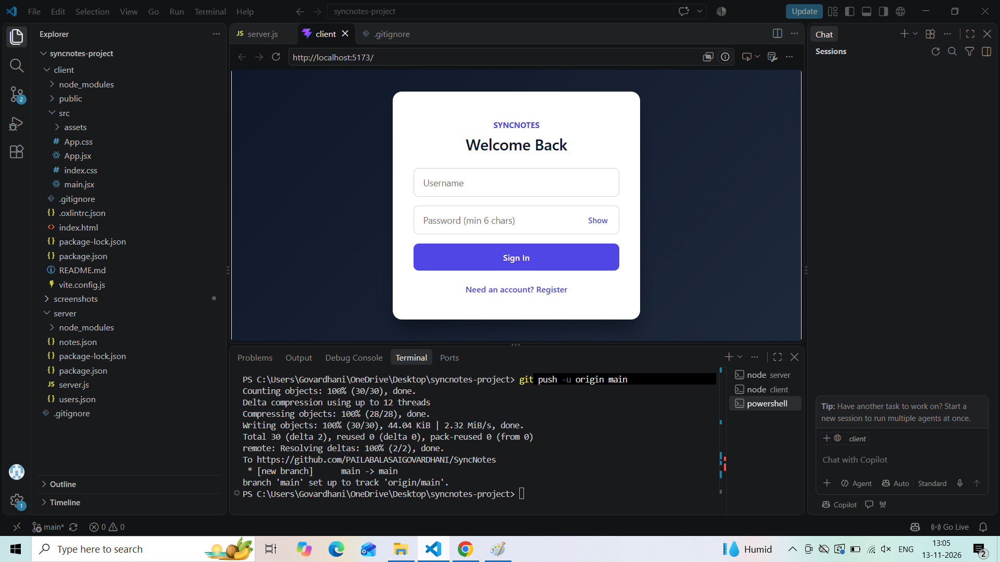
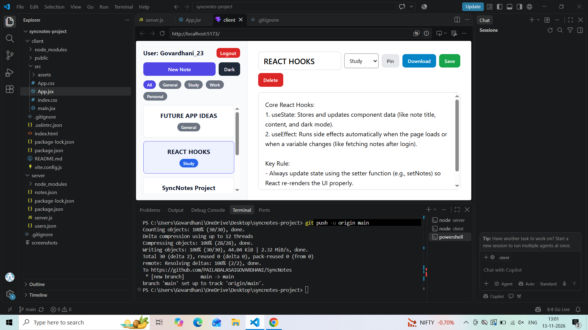
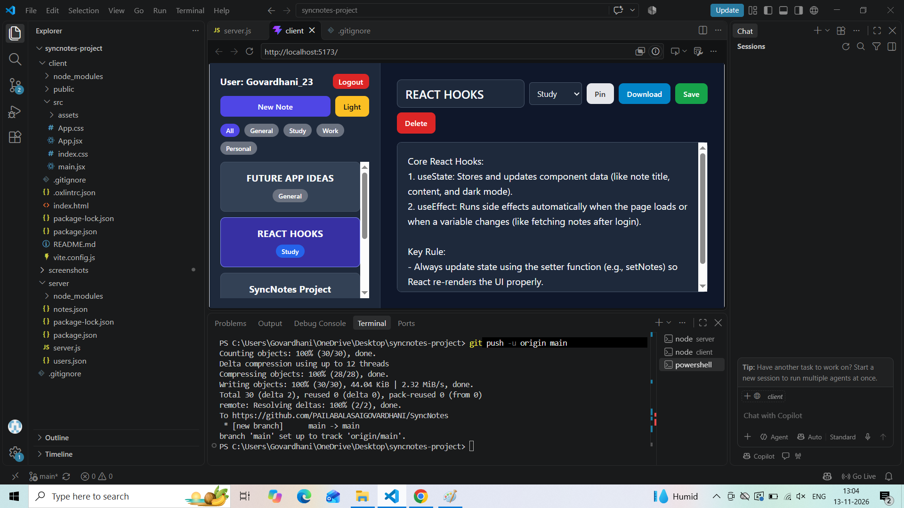

# SyncNotes — Full-Stack Multi-User Notes Workspace

**SyncNotes** is a responsive full-stack web application built with **React (Vite)** and **Node.js (Express)**. It provides a clean workspace where multiple users can create accounts, organize notes by category, and export their work locally.

## How It Works
1. **Authentication & Sessions:** When the app loads, React checks browser localStorage for an active user session. New users register via POST /api/register and returning users log in via POST /api/login, which validates credentials against users.json.
2. **Private Data Isolation:** Once logged in, React requests GET /api/notes/:username. The Express server filters notes.json and returns only the notes owned by that specific username.
3. **Real-Time CRUD & Persistence:** Creating, editing, pinning, or deleting a note sends JSON payloads to Express (POST /api/notes or DELETE /api/notes/:id), updating the local file system immediately so data persists across restarts.
4. **Client-Side Productivity Controls:** Category filtering, Dark Mode theme switching, and .txt file exports (via browser Blob objects) run directly in React for instant responsiveness.

## Key Features
* **Multi-User Authentication:** Account registration and login with password length validation, show/hide password toggle, and persistent browser sessions.
* **Account-Level Data Isolation:** Notes are linked to each user's username so multiple accounts share the backend privately.
* **Category Tagging & Filtering:** Classify notes under **General**, **Study**, **Work**, and **Personal** with color-coded badges and instant filter tabs.
* **Pin-to-Top Priority:** Lock important notes to the top of the sidebar list.
* **Dark & Light Theme Toggle:** Switch seamlessly between a daytime layout and an eye-friendly dark theme.
* **Local .txt Export:** Download any note directly to your computer as a plain-text file.

## What I Learned
* **Full-Stack Client-Server Architecture:** Learned how to decouple a React frontend (port 5173) from a Node.js/Express REST API (port 5000) and connect them using Fetch and CORS.
* **RESTful API Design:** Built custom GET, POST, and DELETE endpoints to handle user authentication and CRUD operations cleanly.
* **State Management & Lifecycle Hooks:** Mastered React useState and useEffect hooks to manage dynamic UI updates, category filtering, and theme toggles.
* **Persistent Storage & Sessions:** Implemented server-side file system operations (fs) for JSON persistence alongside browser localStorage for session retention.
* **Git & GitHub Workflow:** Configured .gitignore rules, structured project directories, and published clean documentation.

## Tech Stack
* **Frontend:** React, Vite, CSS3, Fetch API
* **Backend:** Node.js, Express.js, CORS, File System (fs)
* **Storage:** Persistent JSON files (users.json and notes.json)

## Project Structure
* **client/** — React + Vite frontend (`App.jsx`, `App.css`)
* **server/** — Node.js + Express backend (`server.js`, `notes.json`, `users.json`)
* **screenshots/** — Application UI preview images
* **.gitignore** — Excludes node_modules from version control

## Screenshots

### Login & Registration Screen

### Light Mode Workspace

### Dark Mode Workspace

## How to Run Locally

### 1. Clone the Repository
    git clone https://github.com/PAILABALASAIGOVARDHANI
    cd SyncNotes

### 2. Start the Backend Server
    cd server
    npm install
    node server.js
The Express server starts on http://localhost:5000.

### 3. Start the Frontend Client
Open a second terminal window:

    cd client
    npm install
    npm run dev

Open http://localhost:5173 in your browser.

## 🧑‍💻 Author

**PAILA BALA SAI GOVARDHANI**

Full-Stack Development Learner

## 🔗 Connect With Me

* GitHub: https://github.com/PAILABALASAIGOVARDHANI
* LinkedIn: https://www.linkedin.com/in/balasaigovardhani-paila/

## 📄 License

This project is created for educational and learning purposes.

---

  ⭐ If you like this project, consider giving it a star!
    
  <b>Thank You for Visiting My Project! ❤️</b>

